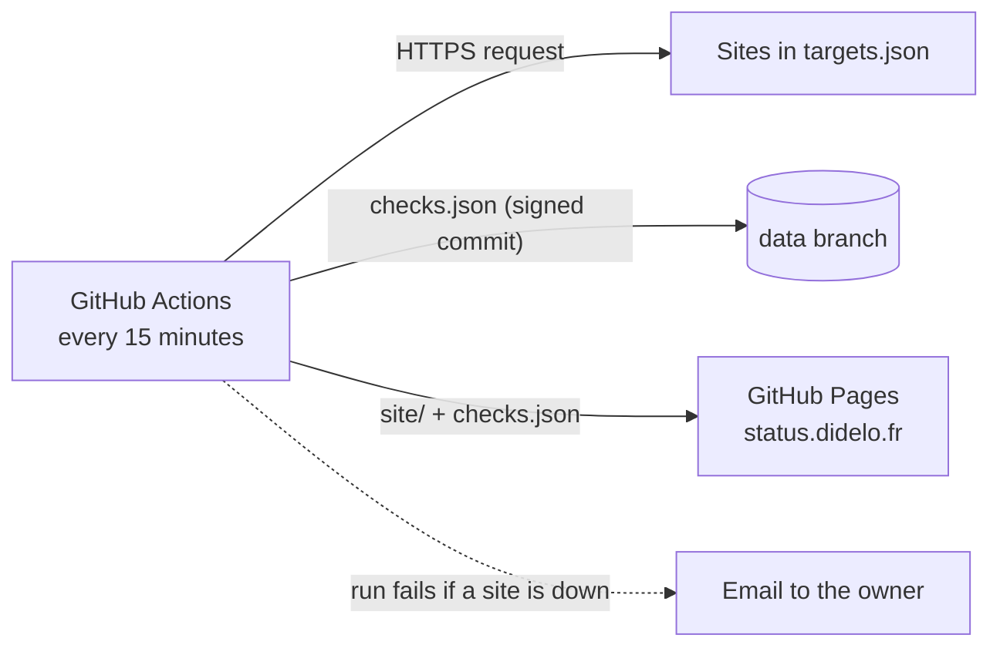

# status

[](https://github.com/Didelo-lilian/status/actions/workflows/ci.yml)
[](https://github.com/Didelo-lilian/status/actions/workflows/probe.yml)
[](LICENSE)

Public status page of my [personal platform](https://github.com/Didelo-lilian/infra), at [status.didelo.fr](https://status.didelo.fr).

It runs on GitHub, not on my server: a status page hosted next to the thing it watches goes down with it. See [ADR 0001](docs/adr/0001-status-page-outside-the-server.md).

## How it works



1. [`probe.yml`](.github/workflows/probe.yml) loads the history from the `data` branch and runs [`probe.py`](probe.py).
2. A failing probe is retried once after 10 seconds, so a blip is not an incident.
3. The result is appended to `checks.json` (30 days kept) and committed to `data` through the API, so GitHub signs the commit.
4. The page is rebuilt from [`site/`](site) plus `checks.json` and deployed to Pages.
5. If a site is down the run ends in failure, and GitHub emails me.

The page is plain HTML, CSS and JavaScript with no dependency and a strict Content-Security-Policy. It shows uptime over 24 hours, 7 days and 30 days, the average response time and recent incidents.

## Add a site

Add an entry to [`targets.json`](targets.json):

```json
{ "key": "my-app", "name": "My app", "url": "https://my-app.didelo.fr" }
```

`key` identifies the history, so never rename it.

## Develop

```bash
make check   # tests, JavaScript syntax, actionlint, gitleaks
make serve   # preview the page with the real history, on http://localhost:8000
```

## Limits

- GitHub runs scheduled workflows on a best-effort basis: a run can start several minutes late. The page shows "No recent data" after 45 minutes without a check.
- GitHub pauses scheduled workflows on a public repository after 60 days without activity. Dependabot and release commits keep it alive; a manual run restarts it.
- The probe checks that the site answers over HTTPS with a valid certificate, from GitHub's network. It does not replace the [Prometheus alerts](https://github.com/Didelo-lilian/infra) that watch the server itself.
